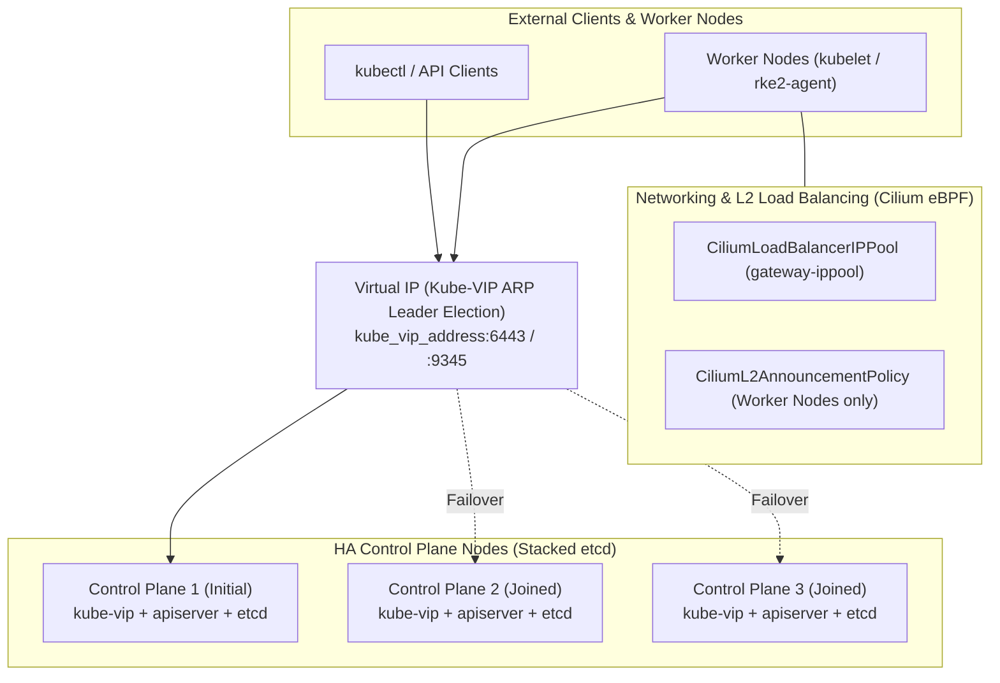

# Automated HA Kubernetes Cluster Deployment with Ansible (`kubeadm` & `RKE2`)

This repository provides production-oriented Ansible playbooks and modular roles for deploying **High Availability (HA) Kubernetes clusters** on Debian/Ubuntu Linux hosts. It supports two distinct Kubernetes distributions out of the box:

1. **Upstream Kubernetes (`kubeadm`)** — [`deploy_kubeadm_kubernetes.yml`](deploy_kubeadm_kubernetes.yml): Standard upstream cluster lifecycle management using `kubeadm`, `containerd`, `Kube-VIP`, CNI (`Cilium` or `Calico`), `Metrics Server`, and `Kyverno`.
2. **Rancher RKE2 (`rke2`)** — [`deploy_rke2_kubernetes.yml`](deploy_rke2_kubernetes.yml): Rancher's security-hardened, CNCF-certified Kubernetes distribution using `Kube-VIP` and RKE2's built-in `HelmChartConfig` addon manager for CNI (`Cilium`, `Calico`, or `Canal`).

---

## Table of Contents

1. [Architecture Overview](#1-architecture-overview)
2. [Repository Structure](#2-repository-structure)
3. [Prerequisites & Requirements](#3-prerequisites--requirements)
4. [Playbook Analysis](#4-playbook-analysis)
   - [4.1 `deploy_kubeadm_kubernetes.yml`](#41-deploy_kubeadm_kubernetesyml)
   - [4.2 `deploy_rke2_kubernetes.yml`](#42-deploy_rke2_kubernetesyml)
   - [4.3 Architectural Comparison (`kubeadm` vs. `RKE2`)](#43-architectural-comparison-kubeadm-vs-rke2)
5. [Configuration & Variables Reference](#5-configuration--variables-reference)
   - [5.1 Global Variables (`group_vars/all.yml`)](#51-global-variables-group_varsallyml)
   - [5.2 `kubeadm` Variables (`group_vars/kubeadm_cluster.yml`)](#52-kubeadm-variables-group_varskubeadm_clusteryml)
   - [5.3 `RKE2` Variables (`group_vars/rke2_cluster.yml`)](#53-rke2-variables-group_varsrke2_clusteryml)
   - [5.4 Role Default Variables](#54-role-default-variables)
6. [Detailed Usage Guide](#6-detailed-usage-guide)
   - [6.1 Step 1: Install Ansible Requirements](#61-step-1-install-ansible-requirements)
   - [6.2 Step 2: Configure the Inventory (`k8s_cluster.yml`)](#62-step-2-configure-the-inventory-k8s_clusteryml)
   - [6.3 Step 3: Customize Cluster Variables](#63-step-3-customize-cluster-variables)
   - [6.4 Step 4: Run the Playbooks](#64-step-4-run-the-playbooks)
   - [6.5 Selective Execution with Ansible Tags](#65-selective-execution-with-ansible-tags)
   - [6.6 Post-Deployment Verification](#66-post-deployment-verification)
7. [Specific Nuances, Unique Features & Edge Cases](#7-specific-nuances-unique-features--edge-cases)
8. [Troubleshooting & Operational Tips](#8-troubleshooting--operational-tips)

---

## 1. Architecture Overview

Both playbooks deploy a **stacked-etcd High Availability (HA) Kubernetes cluster** without requiring an external load balancer appliance:



### Key Architectural Highlights
- **Control Plane High Availability via `Kube-VIP`**: Instead of relying on an external HAProxy/Keepalived setup, `Kube-VIP` runs as a static pod on every control plane node using Layer 2 ARP leader election (`vip_arp: "true"`, `vip_leaderelection: "true"`). If the active leader fails, another control plane node claims the Virtual IP (`kube_vip_address`) within seconds (`vip_leaseduration: 5`, `vip_renewdeadline: 3`, `vip_retryperiod: 1`).
- **Kube-Proxy-less Cilium eBPF Networking**: When `cni_plugin: "cilium"` is selected (the default), traditional `iptables`/`ipvs` `kube-proxy` is disabled (`--skip-phases=addon/kube-proxy` in `kubeadm`, `disable-kube-proxy: true` in `RKE2`). Cilium replaces `kube-proxy` entirely using eBPF programs and communicates directly with the HA Virtual IP (`{{ kube_vip_address }}:6443`).
- **Built-in Bare-Metal Service Load Balancing & Gateway API**: Both playbooks install Kubernetes **Gateway API CRDs** and configure Cilium's **L2 Announcements** (`CiliumL2AnnouncementPolicy`) and IP address management (`CiliumLoadBalancerIPPool`), removing the need for MetalLB.

---

## 2. Repository Structure

```text
.
├── deploy_kubeadm_kubernetes.yml          # Main playbook for upstream kubeadm HA cluster
├── deploy_rke2_kubernetes.yml             # Main playbook for Rancher RKE2 HA cluster
├── k8s_cluster.yml                        # YAML Ansible inventory defining both cluster topologies
├── group_vars/
│   ├── all.yml                            # Shared variables (CIDRs, Kube-VIP, CNI, Gateway API, Cilium)
│   ├── kubeadm_cluster.yml                # kubeadm-specific variables (k8s version, Cilium chart version)
│   └── rke2_cluster.yml                   # RKE2-specific variables (RKE2 version, token, taints)
└── roles/
    ├── kubeadm_kubernetes/
    │   ├── k8s_common/                    # OS prep, swap off, sysctl, containerd, apt repos & k8s packages
    │   ├── kube_vip/                      # Static pod manifest (/etc/kubernetes/manifests/kube-vip.yaml)
    │   ├── control_plane_init/            # kubeadm init, token/cert extraction, K8S_TOKEN_HOLDER, super-admin fetch
    │   ├── control_plane_join/            # super-admin.conf directory fix, secondary control plane join
    │   ├── worker_join/                   # Worker node kubeadm join
    │   ├── certificates/                  # Auto-approval of pending kubelet TLS CSRs
    │   ├── calico_setup/                  # Calico CNI manifest installation (when cni_plugin == 'calico')
    │   ├── cilium_setup/                  # Gateway API CRDs, Helm 3 install, Cilium Helm release & L2 IP pool
    │   ├── metrics_server/                # Kubernetes Metrics Server deployment
    │   └── kyverno_setup/                 # Kyverno Policy Engine installation via Helm
    └── rke2_kubernetes/
        ├── rke2_common/                   # OS prep, swap off, IPv4 forwarding, apt prerequisites
        ├── kube_vip/                      # Static pod manifest (/var/lib/rancher/rke2/agent/pod-manifests/kube-vip.yaml)
        ├── control_plane_init/            # RKE2 server config, HelmChartConfig CNI manifests, Gateway API & L2 IP pool
        ├── control_plane_join/            # Secondary RKE2 server config & join via port 9345
        └── worker_join/                   # RKE2 agent config & installation
```

---

## 3. Prerequisites & Requirements

### Control Node (Ansible Host)
- **Ansible**: `>= 2.15` (required for `ansible.builtin.deb822_repository` used in `k8s_common`).
- **Ansible Collections**: `kubernetes.core` (used for `k8s`, `k8s_info`, `helm`, and `helm_repository` modules).
- **Temporary Storage**: Write access to `/tmp/k8s-super-admin.conf` on the Ansible controller during `kubeadm` deployments.

### Target Nodes (Cluster Hosts)
- **Operating System**: Debian (e.g., Debian 12 Bookworm) or Ubuntu LTS (`apt`-based distributions; note that `k8s_common` configures the Debian Docker repository URL).
- **Privileges**: SSH access with `sudo` / `root` privileges (`become: true` is used across all plays).
- **Network Requirements**:
  - Static IP addresses assigned to all control plane and worker nodes.
  - One unused **Virtual IP (`kube_vip_address`)** in the same Layer 2 broadcast domain as the control plane nodes.
  - One or more unused IP ranges/CIDRs (`gateway_ippool_cidrs`) in the local network (excluded from DHCP) for Cilium LoadBalancer/Gateway API L2 announcements.
  - Consistent network interface naming across control planes matching `kube_vip_interface` (e.g., `eth0` or `ens18`).
  - Outbound internet access to pull packages and container images (`pkgs.k8s.io`, `download.docker.com`, `ghcr.io`, `quay.io`, `registry.k8s.io`, `get.rke2.io`, `github.com`).

---

## 4. Playbook Analysis

### 4.1 `deploy_kubeadm_kubernetes.yml`

This playbook orchestrates a **9-stage deployment** for an upstream Kubernetes cluster:

| Play # | Play Name | Target Hosts | Tag(s) | Role | Summary of Actions |
| :--- | :--- | :--- | :--- | :--- | :--- |
| **1** | `Prepare all nodes` | `kubeadm_cluster` | `prepare_all_nodes` | `kubeadm_kubernetes/k8s_common` | Configures Docker & K8s `deb822` APT repos; disables swap immediately and in `/etc/fstab`; loads `overlay` & `br_netfilter` kernel modules; configures bridge & IPv4 forwarding sysctls; installs `containerd.io` and enables `SystemdCgroup = true`; installs `python3-kubernetes`, `python3-yaml`, and version-pinned `kubeadm`, `kubectl`, `kubelet` (`=<k8s_version>-1.1`) with `dpkg` hold. |
| **2** | `Setup HA Virtual IP via Kube-VIP` | `control_planes` | `kube_vip` | `kubeadm_kubernetes/kube_vip` | Creates `/etc/kubernetes/manifests` and templates the `kube-vip.yaml` static pod manifest on all control plane nodes, mounting `/etc/kubernetes/super-admin.conf`. |
| **3** | `Initialize the first control plane` | `control_planes[0]` | `control_plane_init` | `kubeadm_kubernetes/control_plane_init` | Templates `/root/kubeadm-init.yml` (`v1beta4`); runs `kubeadm init --upload-certs` (skipping `addon/kube-proxy` if Cilium is used); extracts worker & control-plane join commands into an in-memory dummy host `K8S_TOKEN_HOLDER`; sets up `/root/.kube/config`; fetches `/etc/kubernetes/super-admin.conf` to `/tmp/k8s-super-admin.conf` on the controller. |
| **4** | `Join additional control planes` | `control_planes[1:]` | `control_plane_join` | `kubeadm_kubernetes/control_plane_join` | Removes any accidental `/etc/kubernetes/super-admin.conf` directory created by `containerd`, copies `/tmp/k8s-super-admin.conf` from the controller, executes the control-plane join command from `K8S_TOKEN_HOLDER`, and configures `/root/.kube/config`. |
| **5** | `Join worker nodes` | `workers` | `worker_join` | `kubeadm_kubernetes/worker_join` | Joins worker nodes using `hostvars['K8S_TOKEN_HOLDER']['worker_cmd']` (idempotent via `creates: /etc/kubernetes/kubelet.conf`). |
| **6** | `Approve pending kubelet certificates` | `control_planes[0]` | `metrics_server` | `kubeadm_kubernetes/certificates` | Waits 5 seconds, queries `CertificateSigningRequest` resources, and approves pending `kube-apiserver-client-kubelet` and `kubelet-serving` CSRs triggered by `serverTLSBootstrap: true`. |
| **7** | `Install Network Plugin (CNI)` | `control_planes[0]` | `cni_plugin` | `calico_setup` or `cilium_setup` | **If Calico**: Applies `calico.yaml` manifest.<br/>**If Cilium**: Applies Gateway API Standard CRDs, installs Helm 3 to `/usr/local/bin/helm`, deploys Cilium via Helm with `kubeProxyReplacement`, waits for Cilium Operator & DaemonSet readiness, and applies `CiliumLoadBalancerIPPool` & `CiliumL2AnnouncementPolicy`. |
| **8** | `Install Metrics Server` | `control_planes[0]` | `metrics_server` | `kubeadm_kubernetes/metrics_server` | Applies the upstream `metrics-server` `components.yaml` manifest. |
| **9** | `Install Kyverno Policy Engine (Helm)` | `control_planes[0]` | `kyverno` | `kubeadm_kubernetes/kyverno_setup` | Adds the Kyverno Helm repository and installs the `kyverno` Helm chart in the `kyverno` namespace. |

---

### 4.2 `deploy_rke2_kubernetes.yml`

This playbook orchestrates a **5-stage deployment** leveraging RKE2's self-contained architecture:

| Play # | Play Name | Target Hosts | Tag(s) | Role | Summary of Actions |
| :--- | :--- | :--- | :--- | :--- | :--- |
| **1** | `Prepare all nodes` | `rke2_cluster` | `prepare_all_nodes` | `rke2_kubernetes/rke2_common` | Disables swap in memory and `/etc/fstab`; sets `net.ipv4.ip_forward = 1`; creates `/etc/rancher/rke2`; installs APT prerequisite packages (`curl`, `ca-certificates`, `apt-transport-https`, `python3-kubernetes`, `python3-yaml`). |
| **2** | `Setup HA Virtual IP via Kube-VIP` | `rke2_servers` | `kube_vip` | `rke2_kubernetes/kube_vip` | Creates `/var/lib/rancher/rke2/agent/pod-manifests` and templates `kube-vip.yaml` mounting `/etc/rancher/rke2/rke2.yaml`. |
| **3** | `Initialize first control plane node` | `rke2_servers[0]` | `control_plane_init` | `rke2_kubernetes/control_plane_init` | Templates `/etc/rancher/rke2/config.yaml` and CNI `HelmChartConfig` manifests (`rke2-cilium-config.yaml` or `rke2-calico-config.yaml`) in `/var/lib/rancher/rke2/server/manifests/`; installs RKE2 via `https://get.rke2.io` and starts `rke2-server`; if Cilium is enabled, installs Gateway API CRDs, waits for Cilium readiness in `kube-system`, and applies `CiliumLoadBalancerIPPool` & `CiliumL2AnnouncementPolicy`. |
| **4** | `Join additional control plane nodes` | `rke2_servers[1:]` | `control_plane_join` | `rke2_kubernetes/control_plane_join` | Templates `/etc/rancher/rke2/config.yaml` pointing to `server: https://{{ kube_vip_address }}:9345` with `rke2_token_secret`, installs RKE2, and starts `rke2-server`. |
| **5** | `Join worker nodes` | `rke2_agents` | `worker_join` | `rke2_kubernetes/worker_join` | Templates `/etc/rancher/rke2/config.yaml` pointing to `server: https://{{ kube_vip_address }}:9345`, runs RKE2 installer with `INSTALL_RKE2_TYPE="agent"`, and starts `rke2-agent`. |

---

### 4.3 Architectural Comparison (`kubeadm` vs. `RKE2`)

| Feature / Component | `deploy_kubeadm_kubernetes.yml` | `deploy_rke2_kubernetes.yml` |
| :--- | :--- | :--- |
| **Container Runtime** | Installed externally via Docker APT repo (`containerd.io`) | Bundled inside the RKE2 binary/tarball |
| **Node Join Mechanism** | Dynamic bootstrap token & `--certificate-key` generated at runtime (`K8S_TOKEN_HOLDER`) | Static pre-shared token (`rke2_token_secret`) over port `9345` |
| **Kube-VIP Static Pod Path** | `/etc/kubernetes/manifests/kube-vip.yaml` | `/var/lib/rancher/rke2/agent/pod-manifests/kube-vip.yaml` |
| **Kube-VIP Kubeconfig Mount** | `/etc/kubernetes/super-admin.conf` | `/etc/rancher/rke2/rke2.yaml` |
| **CNI Installation Method** | Ansible `kubernetes.core.helm` (Cilium) or `kubernetes.core.k8s` (Calico) | RKE2 built-in Helm controller via `HelmChartConfig` CRDs |
| **Cilium Namespace** | `{{ cilium_namespace }}` (default: `cilium-system`) | `kube-system` (managed by RKE2) |
| **Metrics Server** | Installed via dedicated `metrics_server` role (+ `certificates` role for CSR approval) | Bundled and deployed automatically by RKE2 |
| **Kyverno Policy Engine** | Installed via `kyverno_setup` role | Not included in RKE2 playbook by default |
| **Bundled Ingress** | None (Gateway API ready) | Explicitly disables `rke2-ingress-nginx` and `rke2-traefik` |

---

## 5. Configuration & Variables Reference

### 5.1 Global Variables (`group_vars/all.yml`)

These variables apply to **both** `kubeadm` and `RKE2` clusters:

| Variable | Default Value | Description |
| :--- | :--- | :--- |
| `pod_network_cidr` | `"100.73.0.0/16"` | IPv4 CIDR block allocated for Pod IP addresses across the cluster. |
| `service_network_cidr` | `"100.74.0.0/16"` | IPv4 CIDR block allocated for Kubernetes `ClusterIP` Services (used in `kubeadm`). |
| `kube_vip_version` | `"1.3.1"` | Container image tag for `ghcr.io/kube-vip/kube-vip:v<version>`. |
| `kube_vip_address` | `"192.168.42.10"` | Virtual IP address for the HA Kubernetes API server endpoint. |
| `kube_vip_interface` | `"eth0"` | Network interface on control plane nodes to bind the Virtual IP. |
| `cni_plugin` | `"cilium"` | CNI plugin to deploy. Supported values: `"cilium"` or `"calico"` (RKE2 also supports `"canal"`). |
| `gateway_api_version` | `"1.6.3"` | Version of Kubernetes Gateway API CRDs to install when `cni_plugin == "cilium"`. |
| `gateway_ippool_cidrs` | `["192.168.42.40/32"]` | List of IPv4 CIDRs assigned to `CiliumLoadBalancerIPPool` (`gateway-ippool`) for `LoadBalancer` Services and Gateway API listeners. |
| `cilium_namespace` | `"cilium-system"` | Target namespace for Cilium in `kubeadm` and the `CiliumLoadBalancerIPPool` manifest template. |
| `cilium_k8s_service_host` | `"{{ kube_vip_address }}"` | Kubernetes API host used by Cilium's eBPF kube-proxy replacement. |
| `cilium_k8s_service_port` | `"6443"` | Kubernetes API port used by Cilium's eBPF kube-proxy replacement. |
| `cilium_ipam_mode` | `"cluster-pool"` | Cilium IPAM mode (`"cluster-pool"` or `"kubernetes"`). |

### 5.2 `kubeadm` Variables (`group_vars/kubeadm_cluster.yml`)

| Variable | Default Value | Description |
| :--- | :--- | :--- |
| `ansible_environment` | `production` | Environment identifier metadata. |
| `k8s_major_version` | `"1.36"` | Major.minor version string used for the `pkgs.k8s.io` APT repository URL. |
| `k8s_version` | `"1.36.5"` | Exact Kubernetes version installed (`<pkg>=<k8s_version>-1.1`) and passed to `ClusterConfiguration`. |
| `control_plane_endpoint` | `"{{ kube_vip_address \| default('192.168.42.10') }}:6443"` | Stable HA control plane endpoint passed to `kubeadm init`. |
| `cilium_chart_version` | `"1.20.4"` | Helm chart version for `cilium/cilium`. |

### 5.3 `RKE2` Variables (`group_vars/rke2_cluster.yml`)

| Variable | Default Value | Description |
| :--- | :--- | :--- |
| `ansible_environment` | `production` | Environment identifier metadata. |
| `rke2_version` | `"v1.36.5+rke2r1"` | Exact RKE2 release tag passed as `INSTALL_RKE2_VERSION` to `https://get.rke2.io`. |
| `rke2_token_secret` | `"CHANGEME"` | Shared secret token used by RKE2 servers and agents to join the cluster. **Must be changed before production use.** |
| `rke2_controlplane_node_taint` | `true` | When `true`, taints RKE2 server nodes with `node-role.kubernetes.io/control-plane=true:NoSchedule` so workloads only schedule on `rke2_agents`. |

### 5.4 Role Default Variables

| File | Variable | Default Value | Description |
| :--- | :--- | :--- | :--- |
| `roles/kubeadm_kubernetes/k8s_common/defaults/main.yml` | `kube_prereq_packages` | `[curl, ca-certificates, apt-transport-https, python3-kubernetes, python3-yaml]` | OS packages required on all `kubeadm` nodes. |
| `roles/kubeadm_kubernetes/k8s_common/defaults/main.yml` | `kube_packages` | `[kubeadm, kubectl, kubelet]` | Kubernetes packages installed and held via `dpkg`. |
| `roles/kubeadm_kubernetes/calico_setup/defaults/main.yml` | `calico_version` | `"3.32.2"` | Version of Project Calico manifest applied when `cni_plugin == "calico"`. |
| `roles/kubeadm_kubernetes/metrics_server/defaults/main.yml` | `metrics_server_version` | `"0.8.1"` | Version of Kubernetes Metrics Server manifest. |
| `roles/kubeadm_kubernetes/kyverno_setup/defaults/main.yml` | `kyverno_version` | `"3.8.1"` | Helm chart version for `kyverno/kyverno`. |
| `roles/kubeadm_kubernetes/kyverno_setup/defaults/main.yml` | `kyverno_namespace` | `"kyverno"` | Namespace where Kyverno is deployed. |
| `roles/rke2_kubernetes/rke2_common/defaults/main.yml` | `kube_prereq_packages` | `[curl, ca-certificates, apt-transport-https, python3-kubernetes, python3-yaml]` | OS packages required on all `RKE2` nodes. |

---

## 6. Detailed Usage Guide

### 6.1 Step 1: Install Ansible Requirements

On your Ansible control node, install the `kubernetes.core` collection:

```bash
ansible-galaxy collection install -r roles/kubeadm_kubernetes/calico_setup/requirements.yml
```

### 6.2 Step 2: Configure the Inventory (`k8s_cluster.yml`)

Edit [`k8s_cluster.yml`](k8s_cluster.yml) to set your SSH credentials and node IP addresses.

> **Important**: Both playbooks rely on **host group indexing** (`control_planes[0]` / `control_planes[1:]` and `rke2_servers[0]` / `rke2_servers[1:]`). The **first host** listed under `control_planes` or `rke2_servers` is always treated as the initial seed control plane node, and all subsequent hosts in that group join as secondary control plane nodes.

```yaml
---
all:
  vars:
    ansible_user: <your_ssh_user>
    # Prefer SSH keys or Ansible Vault over plaintext passwords in production:
    ansible_password: <your_ssh_password>
  children:
    default:
      children:
        # Used by deploy_kubeadm_kubernetes.yml
        kubeadm_cluster:
          children:
            control_planes:
              hosts:
                cp1:
                  ansible_host: 10.6.8.220 # Initial control plane (control_planes[0])
                cp2:
                  ansible_host: 10.6.8.221 # Joined control plane (control_planes[1:])
                cp3:
                  ansible_host: 10.6.8.222 # Joined control plane (control_planes[1:])
            workers:
              hosts:
                worker1:
                  ansible_host: 10.6.8.230
                worker2:
                  ansible_host: 10.6.8.231

        # Used by deploy_rke2_kubernetes.yml
        rke2_cluster:
          children:
            rke2_servers:
              hosts:
                rke2-server-1:
                  ansible_host: 10.6.8.220 # Initial server (rke2_servers[0])
                rke2-server-2:
                  ansible_host: 10.6.8.221 # Joined server (rke2_servers[1:])
                rke2-server-3:
                  ansible_host: 10.6.8.222 # Joined server (rke2_servers[1:])
            rke2_agents:
              hosts:
                rke2-worker-1:
                  ansible_host: 10.6.8.230
                rke2-worker-2:
                  ansible_host: 10.6.8.231
```

### 6.3 Step 3: Customize Cluster Variables

1. **Edit [`group_vars/all.yml`](group_vars/all.yml)**:
   - Set `kube_vip_address` to a free IP on your nodes' subnet (e.g., `"10.6.8.210"`).
   - Set `kube_vip_interface` to the primary NIC name on your control plane nodes (verify with `ip -br link`, e.g., `"eth0"` or `"ens18"`).
   - Choose `cni_plugin`: `"cilium"` (recommended) or `"calico"`.
   - Set `gateway_ippool_cidrs` to one or more free IPs/subnets on your LAN for Cilium LoadBalancer Services.
2. **For `kubeadm`, edit [`group_vars/kubeadm_cluster.yml`](group_vars/kubeadm_cluster.yml)**:
   - Verify `k8s_major_version`, `k8s_version`, and `cilium_chart_version`.
3. **For `RKE2`, edit [`group_vars/rke2_cluster.yml`](group_vars/rke2_cluster.yml)**:
   - Change `rke2_token_secret` from `"CHANGEME"` to a strong random token (e.g., `openssl rand -hex 32`).
   - Verify `rke2_version` and `rke2_controlplane_node_taint`.

### 6.4 Step 4: Run the Playbooks

Unlike older manual workflows that required running `--limit` in multiple passes, both playbooks can be executed in a **single command**:

#### Option A: Deploy an Upstream `kubeadm` Cluster
```bash
ansible-playbook -i k8s_cluster.yml deploy_kubeadm_kubernetes.yml
```

#### Option B: Deploy a Rancher `RKE2` Cluster
```bash
ansible-playbook -i k8s_cluster.yml deploy_rke2_kubernetes.yml
```

*(If your `sudo` user requires a password for privilege escalation, append `--ask-become-pass` or `-K`.)*

### 6.5 Selective Execution with Ansible Tags

Both playbooks tag every play so you can run specific lifecycle stages:

#### `deploy_kubeadm_kubernetes.yml` Tags
```bash
# 1. Only prepare OS packages, kernel modules, sysctls, and containerd
ansible-playbook -i k8s_cluster.yml deploy_kubeadm_kubernetes.yml --tags prepare_all_nodes

# 2. Re-deploy or update the Kube-VIP static pod manifest
ansible-playbook -i k8s_cluster.yml deploy_kubeadm_kubernetes.yml --tags kube_vip

# 3. Join newly added worker nodes (MUST include control_plane_init to populate K8S_TOKEN_HOLDER)
ansible-playbook -i k8s_cluster.yml deploy_kubeadm_kubernetes.yml --tags control_plane_init,worker_join

# 4. Approve pending kubelet CSRs and deploy/update Metrics Server
ansible-playbook -i k8s_cluster.yml deploy_kubeadm_kubernetes.yml --tags metrics_server

# 5. Deploy or update the CNI plugin (Cilium / Calico)
ansible-playbook -i k8s_cluster.yml deploy_kubeadm_kubernetes.yml --tags cni_plugin

# 6. Deploy or update Kyverno
ansible-playbook -i k8s_cluster.yml deploy_kubeadm_kubernetes.yml --tags kyverno
```

> **Fine-Grained Sub-Tags in `k8s_common`**: The `k8s_common` role also exposes internal task tags: `apt-repository`, `setup-prerequisites`, `containerd_config`, `install_pre_kube_packages`, and `install_kube_packages`.

#### `deploy_rke2_kubernetes.yml` Tags
```bash
# 1. Prepare all RKE2 nodes
ansible-playbook -i k8s_cluster.yml deploy_rke2_kubernetes.yml --tags prepare_all_nodes

# 2. Deploy Kube-VIP static pod manifests
ansible-playbook -i k8s_cluster.yml deploy_rke2_kubernetes.yml --tags kube_vip

# 3. Initialize the first RKE2 server
ansible-playbook -i k8s_cluster.yml deploy_rke2_kubernetes.yml --tags control_plane_init

# 4. Join additional RKE2 servers (can run standalone since token is static in group_vars)
ansible-playbook -i k8s_cluster.yml deploy_rke2_kubernetes.yml --tags control_plane_join

# 5. Join RKE2 worker agents (can run standalone)
ansible-playbook -i k8s_cluster.yml deploy_rke2_kubernetes.yml --tags worker_join
```

### 6.6 Post-Deployment Verification

#### On a `kubeadm` Control Plane Node (`cp1`)
```bash
export KUBECONFIG=/etc/kubernetes/admin.conf   # Already copied to /root/.kube/config
kubectl get nodes -o wide
kubectl get pods -A
kubectl get ciliumloadbalancerippools,ciliuml2announcementpolicies -A
kubectl top nodes
```

#### On an `RKE2` Server Node (`rke2-server-1`)
RKE2 installs `kubectl` and `crictl` into `/var/lib/rancher/rke2/bin` and stores the kubeconfig at `/etc/rancher/rke2/rke2.yaml`:
```bash
export PATH=$PATH:/var/lib/rancher/rke2/bin
export KUBECONFIG=/etc/rancher/rke2/rke2.yaml
kubectl get nodes -o wide
kubectl get pods -A
```

---

## 7. Specific Nuances, Unique Features & Edge Cases

Understanding the following implementation details is essential when operating or customizing these playbooks:

### 1. The `super-admin.conf` Directory Race Condition & Fix (`kubeadm`)
- **Why `super-admin.conf` is used**: Starting with Kubernetes 1.29+, `kubeadm`'s `/etc/kubernetes/admin.conf` no longer grants unconditional `system:masters` permissions during early bootstrap before RBAC is reconciled. Therefore, `kube-vip.yml.j2` mounts `/etc/kubernetes/super-admin.conf` from the host into `/etc/kubernetes/admin.conf` inside the `kube-vip` container.
- **The Race Condition**: Play 2 (`kube_vip`) places `/etc/kubernetes/manifests/kube-vip.yaml` on **all** control plane nodes (`cp1`, `cp2`, `cp3`) before `kubeadm init` or `kubeadm join` runs. On `cp2` and `cp3`, `kubelet` and `containerd` immediately attempt to start the `kube-vip` static pod. Because `/etc/kubernetes/super-admin.conf` does not exist yet on secondary control planes, `containerd`'s `hostPath` volume mounter automatically creates `/etc/kubernetes/super-admin.conf` as an **empty directory**, which subsequently causes `kubeadm join` to fail!
- **The Built-in Solution**:
  1. In `control_plane_init`, Ansible fetches `/etc/kubernetes/super-admin.conf` from `control_planes[0]` to `/tmp/k8s-super-admin.conf` on the Ansible controller.
  2. In `control_plane_join`, Ansible inspects `/etc/kubernetes/super-admin.conf` on `control_planes[1:]` via `stat`. If `super_admin_stat.stat.isdir` is `true`, it deletes the accidental directory and copies the valid `/tmp/k8s-super-admin.conf` file into place *before* invoking `kubeadm join`.
- **Security Note**: Because `/tmp/k8s-super-admin.conf` contains cluster-wide `system:masters` credentials, remove `/tmp/k8s-super-admin.conf` from the Ansible controller after deployment completes.

### 2. Ephemeral In-Memory Token Sharing (`K8S_TOKEN_HOLDER` in `kubeadm`)
- Instead of writing join tokens and certificate keys to local files, [`roles/kubeadm_kubernetes/control_plane_init/tasks/main.yml`](roles/kubeadm_kubernetes/control_plane_init/tasks/main.yml) uses `add_host` to register a dummy host named `K8S_TOKEN_HOLDER` in Ansible's in-memory inventory containing `worker_cmd` and `cp_cmd`.
- **Nuance when using `--tags` or `--limit`**: Because `K8S_TOKEN_HOLDER` only exists in memory for the duration of the `ansible-playbook` process, running `--tags control_plane_join` or `--tags worker_join` by itself will fail with an undefined `hostvars['K8S_TOKEN_HOLDER']` error unless `control_plane_init` is also included (`--tags control_plane_init,worker_join`). Since `control_plane_init` checks if `/etc/kubernetes/admin.conf` already exists, re-running `control_plane_init` on an initialized cluster safely skips `kubeadm init` and only generates a fresh join token and certificate key.

### 3. Automated Kubelet Server TLS Bootstrapping & CSR Approval (`kubeadm`)
- By default, `kubeadm` configures kubelets with self-signed serving certificates, which causes `metrics-server` to fail TLS verification unless `--kubelet-insecure-tls` is passed.
- This repository solves this properly:
  1. [`init.yml.j2`](roles/kubeadm_kubernetes/control_plane_init/templates/init.yml.j2) sets `serverTLSBootstrap: true` inside `KubeletConfiguration`.
  2. Play 6 ([`roles/kubeadm_kubernetes/certificates/tasks/main.yml`](roles/kubeadm_kubernetes/certificates/tasks/main.yml)) waits 5 seconds after nodes join, queries the API server for pending `CertificateSigningRequest` resources signed by `kubernetes.io/kube-apiserver-client-kubelet` or `kubernetes.io/kubelet-serving`, and approves them via `kubectl certificate approve`.
- **Nuance**: Both Play 6 (`certificates`) and Play 8 (`metrics_server`) share the tag `metrics_server`. If you add new worker nodes later, re-run `--tags metrics_server` to approve the new nodes' kubelet serving CSRs.

### 4. Cilium L2 Announcement Interface & Node Selection Rules
- Both [`roles/kubeadm_kubernetes/cilium_setup/templates/loadbalancerippool_l2announcementpolicy.yml.j2`](roles/kubeadm_kubernetes/cilium_setup/templates/loadbalancerippool_l2announcementpolicy.yml.j2) and [`roles/rke2_kubernetes/control_plane_init/templates/loadbalancerippool_l2announcementpolicy.yml.j2`](roles/rke2_kubernetes/control_plane_init/templates/loadbalancerippool_l2announcementpolicy.yml.j2) configure `CiliumL2AnnouncementPolicy` with two important constraints:
  1. **Worker-Only Announcements**: The `nodeSelector` excludes nodes with the `node-role.kubernetes.io/control-plane` label (`operator: DoesNotExist`). If you deploy a control-plane-only cluster without worker nodes, L2 announcements will not be advertised until you remove or adjust this `nodeSelector`.
  2. **Interface Regex Matching**: Announcements are restricted to interfaces matching `^ens[0-9]+` or `^eth[0-9]+`. If your bare-metal servers or VMs use predictable interface names like `eno1`, `enp3s0`, or `bond0`, update the `interfaces` list in `loadbalancerippool_l2announcementpolicy.yml.j2`.

### 5. Gateway API CRD URL & Cilium Namespace Differences (`kubeadm` vs. `RKE2`)
- **Gateway API Release URL**:
  - In `kubeadm` ([`roles/kubeadm_kubernetes/cilium_setup/tasks/main.yml`](roles/kubeadm_kubernetes/cilium_setup/tasks/main.yml)), the CRD URL is `.../releases/download/v{{ gateway_api_version }}/standard-install.yaml` (prefixed with `v`, standard channel).
  - In `RKE2` ([`roles/rke2_kubernetes/control_plane_init/tasks/main.yml`](roles/rke2_kubernetes/control_plane_init/tasks/main.yml)), the CRD URL is `.../releases/download/{{ gateway_api_version }}/experimental-install.yaml` (without a `v` prefix, experimental channel). Because `gateway_api_version` in `group_vars/all.yml` is `"1.6.3"` (no leading `v`), ensure the `v` prefix is present in `roles/rke2_kubernetes/control_plane_init/tasks/main.yml` before running the RKE2 playbook with Cilium.
- **Cilium Namespace**:
  - In `kubeadm`, Cilium is deployed into `{{ cilium_namespace }}` (`cilium-system`).
  - In `RKE2`, RKE2's built-in Helm controller deploys `rke2-cilium` into `kube-system`.

### 6. Kyverno's Implicit Dependency on Helm (`kubeadm`)
- In `deploy_kubeadm_kubernetes.yml`, the `/usr/local/bin/helm` binary is downloaded and installed inside [`roles/kubeadm_kubernetes/cilium_setup/tasks/main.yml`](roles/kubeadm_kubernetes/cilium_setup/tasks/main.yml).
- If you set `cni_plugin: "calico"`, the `cilium_setup` role is skipped, which means `helm` will not be installed before Play 9 (`kyverno_setup`) runs. If using Calico with Kyverno, either pre-install Helm on `control_planes[0]` or skip Kyverno with `--skip-tags kyverno`.

### 7. Aggressive `/var/lib/dpkg/lock` Removal & Containerd Config Reset
- Both `k8s_common` and `rke2_common` include tasks that delete `/var/lib/dpkg/lock` before installing APT packages. Ensure no background `apt` or `unattended-upgrades` process is actively writing to the package database when starting the playbook.
- In `k8s_common`, `/etc/containerd/config.toml` is unconditionally deleted and regenerated from `containerd config default` with `SystemdCgroup = true`. Any manual customizations to `/etc/containerd/config.toml` will be overwritten if `prepare_all_nodes` is re-run.

---

## 8. Troubleshooting & Operational Tips

### Cilium Pods Stuck or L2 LoadBalancer IPs Not Responding
If Gateway API CRDs or L2 policies were modified after Cilium started, restart the Cilium operator and agent DaemonSet (as noted in [`roles/kubeadm_kubernetes/cilium_setup/hinweis.md`](roles/kubeadm_kubernetes/cilium_setup/hinweis.md)):
```bash
# For kubeadm (default namespace: cilium-system)
kubectl -n cilium-system rollout restart deployment/cilium-operator
kubectl -n cilium-system rollout restart ds/cilium

# For RKE2 (namespace: kube-system)
kubectl -n kube-system rollout restart deployment/cilium-operator
kubectl -n kube-system rollout restart ds/cilium
```

### Kube-VIP Virtual IP Not Reachable
1. Verify that `kube_vip_interface` in [`group_vars/all.yml`](group_vars/all.yml) matches the actual network interface name on your control plane nodes (`ip addr`).
2. Check that your hypervisor/cloud network allows **gratuitous ARP / MAC spoofing** (e.g., disable MAC address filtering or enable forged transmits/promiscuous mode on VMware vSphere / Proxmox / OpenStack ports if ARP announcements are blocked).
3. Inspect the static pod logs on the control plane node:
   ```bash
   crictl ps -a | grep kube-vip
   crictl logs <container-id>
   ```

### Switching Calico to Tigera Operator Mode (`kubeadm`)
By default, [`roles/kubeadm_kubernetes/calico_setup/tasks/main.yml`](roles/kubeadm_kubernetes/calico_setup/tasks/main.yml) applies the standalone `calico.yaml` manifest. If you need custom CIDR encapsulation (`VXLANCrossSubnet`) via the Tigera Operator, uncomment the Tigera Operator tasks in `roles/kubeadm_kubernetes/calico_setup/tasks/main.yml`, which automatically render [`custom-resources.yml.j2`](roles/kubeadm_kubernetes/calico_setup/templates/custom-resources.yml.j2) using `{{ pod_network_cidr }}`.
